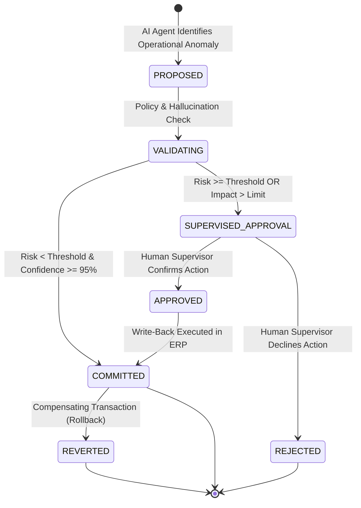

<div align="center">

# Supervised Action Protocol (SAP)

**An open enterprise standard for policy-governed autonomous decision execution and cryptographic auditability.**

[](spec/v1.0.md)
[](LICENSE)
[](https://github.com/Omnesight/.github/blob/main/SECURITY.md)

</div>

---

## The Enterprise Challenge

In mission-critical enterprise operations (heavy industry, supply chain, energy utilities), traditional AI suffers from two polar failures:
1. **Passive Dashboards:** Insights rot on business intelligence screens without closing the loop.
2. **Ungoverned Autonomy:** Unconstrained LLM autonomous agents risk catastrophic transactional write-backs, phantom purchase orders, and ledger corruption.

The **Supervised Action Protocol (SAP)** solves this by establishing a deterministic, cryptographically auditable state machine between cognitive intelligence engines and core enterprise systems (SAP, Oracle, SCADA).

---

## State Transition Machine



---

## Core Guarantees

* **Zero Ungoverned Write-Backs:** No transaction with financial impact exceeding configured policy limits (e.g., $10,000 USD) can execute without an explicit cryptographic signature from an authorized human supervisor.
* **Cryptographic Provenance:** Every action generates a SHA-256 audit hash binding the raw telemetry trigger, model checkpoint, policy evaluations, and executor identity.
* **Idempotency & Rollback Guarantees:** Every state transition implements compensating transaction logic for deterministic rollbacks in enterprise ledgers.

---

## Repository Structure

```text
supervised-action-protocol/
├── schemas/
│   └── action.schema.json      # Formal JSON Schema draft 2020-12
├── spec/
│   └── v1.0.md                 # Full RFC-style protocol specification
├── LICENSE                     # Apache 2.0 License
└── README.md
```

---

## Reference Implementations

* **Python SDK:** [`omnesight-python`](https://github.com/Omnesight/omnesight-python)
* **Enterprise Cookbooks:** [`enterprise-cookbooks`](https://github.com/Omnesight/enterprise-cookbooks)

---

## License

Apache License 2.0. Copyright 2026 Omnesight.
